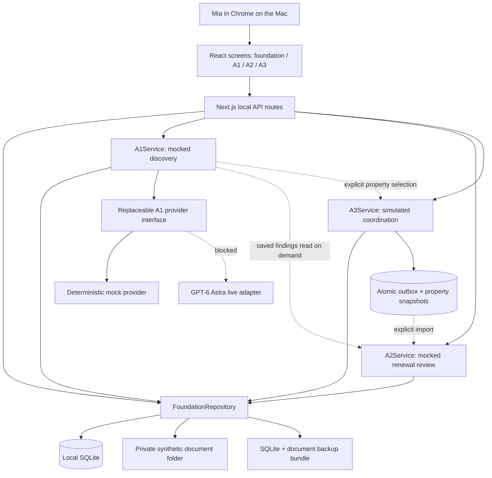
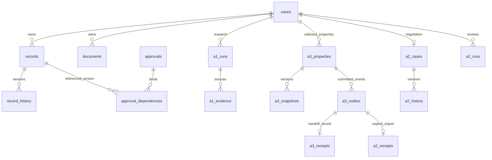
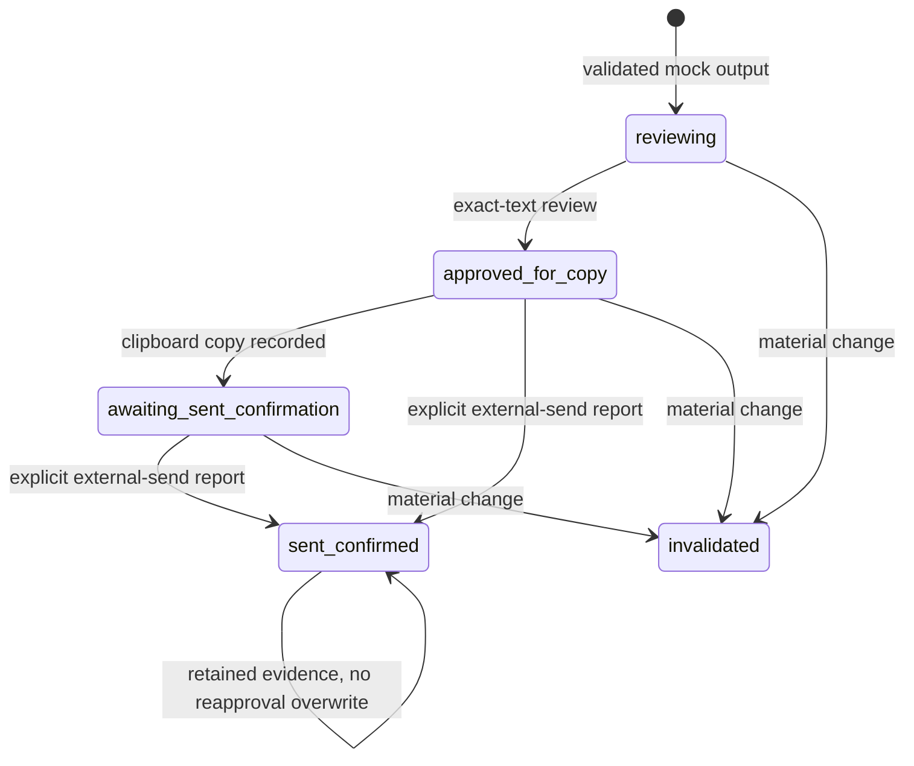

# Tenant demo: as-built HLD and LLD inventory

Snapshot: after the verified A2 correctness fixes and A1 base-only discovery alignment. This document describes code actually present, not the full PRD target. Paths are relative to `tenant-demo/`. Documentation-only inspection; no application changes or new test runs in this documentation task.

## 1. High-level design

A local, single-user Next.js application serves four React screens and four same-origin JSON endpoints from one Node process. A1, A2 and A3 are service modules, not microservices, autonomous background workers or separate LLM agents. The application uses deterministic synthetic research/writing/replies. UI actions advance work explicitly.



There is no fourth LLM supervisor, n8n workflow, email transport, calendar integration, bank/inbox connection, model API credential or external hosting in this checkpoint.

### Runtime and deployment boundary

- `package.json`: Next 16.4.3; React/React DOM 19.2.0; TypeScript ^5.9; Node types ^24; ESLint ^9. Built-in `node:sqlite`, no database service dependency.
- `npm run build`, then `npm run start`: Next server binds `127.0.0.1:3000`. `dev` also binds loopback.
- `src/server/runtime.ts`: process-cached FoundationRepository. `/api/a1` also caches A1Service to retain AbortControllers. A2/A3 service objects are created per request over the same repository.
- `src/server/repository.ts`: data defaults to `../foundation-data`, overridable by `TENANT_DATA_DIR`. That is outside `.next`, source and temporary directories. `foundation.sqlite`, `documents/`, `backups/` live there.
- This is not multi-user authentication or production tenant isolation. API host/origin checks and OS directory permissions support local use; they do not substitute for an authenticated hosted system.

### Module boundaries

| Responsibility | Active files |
|---|---|
| Layout/styles | `src/app/layout.tsx`, `src/app/globals.css` |
| Foundation screen/API | `src/app/page.tsx`, `src/app/api/foundation/route.ts` |
| A1 screen/API | `src/app/a1/page.tsx`, `src/app/api/a1/route.ts` |
| A2 screen/API | `src/app/a2/page.tsx`, `src/app/api/a2/route.ts` |
| A3 screen/API | `src/app/a3/page.tsx`, `src/app/api/a3/route.ts` |
| Shared records, permissions, backup | `src/server/contracts.ts`, `src/server/repository.ts`, `src/server/runtime.ts` |
| SQL schema | `src/server/migrations.ts` |
| Explicit fixture changes | `src/server/fixture-v03.ts`, `scripts/sync-a2-v03.ts`, `scripts/align-a1-discovery.ts`, earlier `scripts/apply-approved-fixture.ts`, `scripts/apply-path-preference.ts` |
| A1 orchestration | `src/server/a1/service.ts` |
| A1 domain | `src/a1/contracts.ts`, `engine.ts`, `strategy.ts`, `schema.ts`, `fixtures.ts`, `provider.ts`, `prompt.ts` |
| A2 orchestration | `src/server/a2/service.ts` |
| A2 domain | `src/a2/contracts.ts`, `schema.ts`, `math.ts`, `mock.ts`, `mock-language-policy.ts`, `prompt.ts` |
| A3 orchestration | `src/server/a3/service.ts` |
| A3 domain | `src/a3/contracts.ts`, `schema.ts`, `scheduling.ts`, `report.ts`, `prompt.ts` |
| Preserved original A1 prompt | `src/a1/history/prompt-v05.ts` |

`src/lib/` contains earlier local-storage/domain/provider modules still exercised by legacy tests. Current app/server/agent routes do not import them. `src/preserved/` contains earlier UI artifacts. Do not diagram these as the active persistence backend or current agent implementations.

## 2. Low-level HTTP contracts

All four route modules use Node runtime and force-dynamic responses. Normal successful views have `Cache-Control: no-store`. Errors generally return HTTP 400 with `{error:string}`. Only GET and POST handlers are implemented.

Common safeguards: host must be localhost/127.0.0.1 with optional port; writes require matching Origin host and JSON Content-Type. Per-route body character caps: foundation 20,000; A1 5,000; A2 20,000; A3 15,000. These are character-length checks, not general streaming byte limits. Route bodies are manually dispatched after JSON parsing, not a generated OpenAPI/discriminated request-schema framework. Domain payloads and output contracts receive separate validation.

### Foundation: `/api/foundation`

GET `?case=id` returns `{cases, case:repo.view(id), storage}`. Without case selects/bootstraps first synthetic case. GET `?case=id&history=recordId` returns history; `?case=id&document=id` downloads the synthetic text document; `?backup=id` downloads a tar bundle.

POST common fields: `action`, usually `caseId`, stable `operationId`. Return updated snapshot; backup adds `{backup:{id,documents}}`.

| Action | Additional inputs / behavior |
|---|---|
| `fresh-case` | Creates new case, preserving previous cases |
| `save-search` | `recordId,data,expectedVersion`; changing PATH limit is denied here |
| `add-synthetic-document` | Creates only a synthetic text evidence artifact |
| `start-storage-run` | Storage-only checkpoint exercise, no agent work |
| `checkpoint`, `complete-storage-run` | `runId` |
| `resume-storage-run` | `runId`, explicit manual recovery |
| `backup` | Consistent database/document export |

### A1: `/api/a1`

GET `?case=id`: `{cases,caseId,preferences:StoredRecord,runs}`. Run views expose status, validity, findings, trace, simulated accounting and error.

| POST action | Fields beyond `caseId` |
|---|---|
| `start` | `operationId,scenario,trigger,expectedVersion` |
| `advance` | `runId,expectedStep` |
| `stop`, `resume` | `runId` |
| `approve-expansion` | `runId,expectedVersion,confirmed,operationId` |

Scenarios: S1–S6, no-match, malformed. Triggers: on-demand or simulated-refresh only. Returned view replaces client state. UI stores selected case/pending request identifiers locally for recovery; research records are server-side.

### A2: `/api/a2`

GET `?case=id`: service view plus cases/mode. Service view: `state`, `latestCosts`, `drafts` with calculated validity, `runs`, `receipts`, `availableA3Events`, `legalCoverage`, `fixtureVersion`.

POST common fields: `action,caseId,operationId,version`; some run controls use `id` and do not use the state version. Normal response is the updated view.

| Action | Specific fields / effect |
|---|---|
| `confirm` | `confirmed===true`; confirms mocked facts only |
| `start` | `trigger`: opening/counteroffer/uncertainty |
| `advance`, `stop`, `resume` | `id` = run ID |
| `approve` | `id` = draft ID; exact text/dependency approval |
| `copy-text` | `id`; returns `{text}` after approval gate; does not mark sent |
| `copied` | `id`; records awaiting-sent-confirmation |
| `sent` | `id,mode,actualText?,confirmed`; mode as_drafted/externally_edited |
| `counter` | Records fixed explicitly synthetic first counter, not a live received message |
| `risk` | `risk` from service allowlist |
| `ingest` | `eventId` from committed A3 outbox |
| `missing` | `agent,fields`; held, deduplicated zero-budget request |
| `decision` | stay/leave; no external notice |
| `sign` | `terms,confirmed`; records explicit external-signing assertion, performs no signing |

Service-only `conflict` supports synthetic extraction-conflict testing but is not exposed as a route action. Actual outgoing clipboard write occurs in `src/app/a2/page.tsx` using `navigator.clipboard.writeText`, followed by `copied`. Sending remains outside the app. Current UI remembers selected case in localStorage; SQLite is authoritative.

### A3: `/api/a3`

GET `?case=id`: `{caseId,cases,preferences,questions,options,properties,cost:0,mode:'simulation'}`. `options` derive from current valid synthetic A1 findings; selection can preserve near-match/unknown candidates within the permitted PATH boundary, so it is not proof of fit.

POST uses `caseId,operationId`, often property `id,version`.

| Actions | Inputs / behavior |
|---|---|
| `select` | `runId,candidateId` |
| `consent` | `yes:boolean` |
| `preferences` | `preferences,expectedVersion,approved` |
| `send`, `followup` | typed `proposal`; writes simulated conversation only |
| `advance` | `now,approved`; explicit forward demo clock |
| `partial-costs`, `conflict`, `mia-call` | Generate labeled synthetic incoming claims |
| `request-viewing` | `start,end` |
| `confirm-viewing` | Confirms currently requested exact slot using synthetic property source |
| `cancel`, `feedback` | Cancel pending state / add synthetic Mia feedback |
| `property-unresolved`, `mia-unresolved` | Mark clarification attempts exhausted |
| `research-record` | Held request for utilities/application_fee, zero dispatch budget |
| `review-boundary` | Records batched minor handoff receipts |

After POST, `dispatch(caseId)` records applicable A3 receipts. It does not call A2 analysis. Service-only queue/failure/recovery/estimate functions are testable but not all have public API controls.

## 3. Domain schemas and validations

### Shared records

`src/server/contracts.ts`: `StoredRecord={id,caseId,group,version,data,updatedAt}`. Nine generic groups: search-profile, private-finance, housing-case, evidence-claim, market-finding, selection, negotiation, consent, outreach. Payload keys are allowlisted per group; reference ownership is checked in the repository. Specialized agent tables supplement these groups rather than forcing every agent state into generic records.

`readForAgent` in `src/server/repository.ts`:
- A1: search-profile and market-finding only.
- A2: search-profile, private-finance, housing-case, evidence-claim, market-finding, selection, negotiation, outreach.
- A3 generic view: selected findings/selections and related consent/outreach; private selection notes stripped; consent shown authorized only with current dependencies.
- Document reads enforce case/agent access. These are application-level boundaries, not separate OS/database users. Owner-facing local APIs may display private information to Mia.

### A1

`src/a1/contracts.ts`: Runtime carries current preference versions, timezone/trigger, run IDs, prior findings version, preparation milestone, capability flags and limits. Evidence records include stable IDs, optional origin ID, source URL, retrieval/publication time, field/value, claim, verified/conflict/stale flags and run-linked recheck identity.

Candidate → Assessed: per-field filters, discovery base, known mandatory subtotal or null, cost warnings, ranking, facts/inferences/unknowns. Result contains groups, opportunity ledger, dated PATH counts, material changes and typed A2/A3 preparation handoffs. `src/a1/schema.ts` validates nested output independently; `provider.ts` separately compares deterministic semantic fields against application-calculated results while allowing selected prose fields to differ.

`engine.ts` performs hard filtering, evidence conflict handling/deduplication, ranking, semantic deltas, counts and handoff preparation. `strategy.ts` provides bounded discovery/fallback/unknown verification/alternate-query paths. No search API is invoked.

### A2

`src/a2/contracts.ts`: Evidence includes source/type/location/time/provenance/confirmation/conflicts/version; Terms are base, amenity, trash, months; Reply preserves received text and explicit structured acknowledgments. Runtime carries private approved economics and saved A1/A3 context, without future scripted outcome.

Output v2 separates private recommendation, outgoing draft, requested terms, sources, proposed attachments, calculation inputs, handoff requests, approvals, changes, progress and stop reason. Outgoing draft has typed clause/source/version bindings; private recommendation has a controlled decision code.

`schema.ts` independently checks complete nested shape, reference existence and confirmation. `mock-language-policy.ts` checks current numerical terms, supported synthetic clauses, source versions/citations, private decision/status/progress language and rejects private inference in outgoing metadata. `math.ts` is deterministic and tested independently. `mock.ts` supplies synthetic wording; no transport exists.

The evidence binding uses exact approved synthetic evidence clauses; it is not an NLP entailment engine or real extraction system. Broader legitimate language requires future separately evaluated handling.

### A3

`src/a3/contracts.ts`: Property aggregate contains consent, cost claims, appointment, feedback, evidence, estimates, held research requests, follow-up count, processed IDs, explicit demo clock, queued proposals and execution budget state. Viewing preferences include dates/hours/weekends/timezone/approved windows, version, duration and travel buffer.

Claims distinguish field/value/null, currency, billing unit, known/unknown, conditions, source/date, origin, conflicts and revision. Proposals bind property, recipient, state/consent version, action, disclosure fields and evidence. Event envelope includes schema/event/aggregate versions, causation, consent version, references and materiality flag.

`schema.ts`: independent nested parsing. `scheduling.ts`: explicit offset/IANA-zone consistency, nonexistent/ambiguous DST rejection, approved windows/hours/weekends/duration and collisions with travel buffers. `report.ts`: recurring/nonrefundable/refundable subtotals; incompatible currency/unit or conflicts stay unknown/excluded, never silently USD-normalized; concessions not automatically applied.

## 4. SQLite schema and migrations

`src/server/migrations.ts`: `PRAGMA user_version=8`. Migrations run in transactions. Newer unsupported schemas fail closed. `repository.ts` enables foreign keys, WAL, synchronous FULL and 5-second busy timeout. Database file mode 0600; private directories 0700. JSON TEXT stores typed aggregates; there is no ORM.

| Version | Change |
|---|---|
| 1 | Generic cases/records/history/documents/approvals/dependencies/runs/steps/operations/events |
| 2 | Run cost/error fields and record/event indexes |
| 3 | Run-history table and backfill |
| 4 | Generic operation results replace full record payload with historical record reference |
| 5 | A1 run/trace/evidence/memory and global active-run unique index |
| 6 | A1 cost_status |
| 7 | A3 aggregate/snapshot/preferences/history/ledger/outbox/receipt/audit tables |
| 8 | Fixture metadata and A2 aggregate/history/operations/runs/audit/receipts |

### Tables, keys and purpose

| Table | Primary/unique key and principal columns |
|---|---|
| cases | id; label, created_at |
| records | id; case_id FK, group_name, version, data, updated_at |
| record_history | (record_id,version); case_id, group_name, data, at |
| documents | id; case_id FK, name, sha256, relative_path, bytes, created_at, synthetic |
| approvals | id; case_id FK, target_id, status, created_at, invalidated_at |
| approval_dependencies | (approval_id,record_id); approval_id FK, version |
| runs | id; case_id FK, agent, status/checkpoint, unique operation_id, owner_runtime, timestamps, cost_microusd/error_code |
| run_steps | (run_id,operation_id); run_id FK, checkpoint, completed_at |
| run_history | integer id; run_id FK, status/checkpoint/cost/error/time |
| operations | id; case_id, fingerprint, result, created_at |
| events | integer id; case_id, entity_id, kind, at |
| a1_runs | id; case_id FK, unique operation_id, scenario/status/runtime/step/candidates/failures/result, timestamps/owner, model_requests/cost/error/cost_status |
| a1_trace | integer id; run_id FK, event, details, at |
| a1_evidence | (run_id,candidate_id,evidence_id); run_id FK, data |
| a1_memory | id; case_id FK, field, replaces_value/value/provenance, constraints_version, at |
| a3_properties | id; case_id FK, version, data |
| a3_snapshots | (property_id,version); data |
| a3_preferences | case_id PK/FK; version, data |
| a3_preference_history | (case_id,version); data |
| a3_preference_operations | id; fingerprint, result |
| a3_ledger | action_id; property_id, fingerprint, version, result |
| a3_outbox | event_id; property_id, version, data |
| a3_receipts | event_id; property_id, version, status, review_flag |
| a3_audit | integer id; property_id, version, code, at |
| fixture_sync | case_id; version, data, at |
| a2_cases | case_id PK/FK; version, data |
| a2_history | (case_id,version); data, at |
| a2_operations | id; case_id, fingerprint, result |
| a2_runs | id; case_id, status, owner_runtime, data |
| a2_audit | integer id; case_id, run_id, code, at, details |
| a2_receipts | event_id; case_id, aggregate_id/version, review_flag, snapshot, status |

Not every logical relationship is an SQL FOREIGN KEY. Agent services enforce additional case/property/version ownership checks. Unique partial indexes: one running A1 globally; one running A2 per case. A3 has per-property version/operation gates, not a global run table.



Diagram shows logical relationships, not a claim that every edge is a declared FK.

## 5. State machines, authorization and idempotency

### Shared storage

`operation(id,caseId,input,fn)` hashes inputs, begins IMMEDIATE transaction, replays an identical completed operation or rejects mismatched reuse. Updates require expected version; previous values enter history. Generic approvals bind record/version dependencies; relevant changed or new evidence invalidates them. Fresh case adds records, never deletes old ones. Bootstrap only seeds when no case exists.

### A1

Running → completed / partial / stopped. Process ownership mismatch makes unfinished work interrupted; explicit resume requires current constraints/policy and no already-attempted model operation. A completed output is current only if it is the latest run for the case, completed, matches preference version and current validation version.

Search stages persist candidates/evidence/trace atomically. Stop aborts the active provider signal, and state is checked after provider completion to prevent late completion. PATH expansion requires latest completed run, matching preference version, positive same-set additional count, active limit 5 and explicit confirmation; saves versioned limit 10. No >10 relaxation.

### A2

Run: running → paused for human review / stopped; process restart → interrupted → manual resume. Draft: reviewing → approved_for_copy → awaiting_sent_confirmation → sent_confirmed; material changes invalidate draft use. The type also includes copied, but current `copied()` directly saves awaiting_sent_confirmation. Reapproving an already-sent draft is rejected; external actual text is separate from draft, or explicitly unknown.

Dependency hash includes semantic-policy version, relevant foundation record versions, latest A1 validity, nonminor A3 outbox events and A2 material revision. Approval binds exact outgoing-text hash plus dependency hash. Draft creation and run pause are one transaction. Case changes are fingerprinted/idempotent with optimistic version checks. Signing is an explicit assertion of completed external signing matching latest actual terms and stay decision, not an app signature operation.



A sent historical draft may become invalid for reuse while its sent evidence remains retained; the UI's calculated validity is distinct from the persisted draft state label.

### A3

Selection is not consent. Consent yes/no is property-, recipient-, action-, disclosure- and version-bound. Execution rechecks current A1 findings, selected property, granted/not-revoked consent and allowed action/disclosures. Stale queued proposals fail state/version checks. Stable action IDs replay exact prior results; mismatched reuse fails. Revoke clears queued work and cancels pending/proposed appointments with a cancellation event in the same transaction.

Appointment: proposed/requested → confirmed only on exact synthetic property-confirmed slot; cancelled is explicit. Scheduling validates approved windows and 30-minute duration + 30-minute travel buffer defaults; changed timing requires approval. Confirmed slots remain synthetic records, never real calendar bookings.

## 6. Event and handoff flow

```mermaid
sequenceDiagram
  participant UI as Local UI
  participant A3 as A3Service
  participant DB as SQLite
  participant A2 as A2Service
  UI->>A3: synthetic property cost reply + operation/version
  A3->>DB: BEGIN IMMEDIATE
  A3->>DB: property + snapshot + audit + ledger + outbox
  A3->>DB: COMMIT
  A3->>DB: record applicable handoff receipt
  Note over A3,DB: Minor events may wait for review boundary
  Note over A2: No automatic analysis subscription
  UI->>A2: ingest committed event ID explicitly
  A2->>DB: load exact aggregate/version snapshot
  A2->>DB: receipt + state/history + operation atomically
  Note over A2,DB: Duplicate ignored; older receipt historical; material update invalidates draft
  UI->>A2: start and advance new mocked review
```

Event types: costs_updated, appointment_status_changed, viewing_feedback_recorded, cost_research_requested. Outbox is durable local data, not a network queue. A3 receipt “handoff recorded; not analyzed” is not A2 analysis. A2 has its own receipt table after explicit import. A3 missing-cost requests and A2 missing requests remain recorded_not_dispatched; zero hop/call/spend budgets prevent a new A3→A1 research loop.

## 7. Execution limits and OFF gates

| Module | Actual limits and behavior |
|---|---|
| A1 | Four mock research stages; one mock provider request; 120-second run deadline with timer/AbortController during async provider wait; bounded fallback/no-progress; no auto retry. Global running index. Runtime/local input estimate limit 4,000 and 200KB envelope/output guards. 4,000 output-token intent is not tokenizer-enforced live output; actual provider max_output_tokens remains future gated work. Unknown provider billing state remains uncertain. |
| A2 | One active run per case; eight steps; one retry for recoverable mock operation; stop after two no-progress steps; 120-second deadline checked at advance; synchronous local generation, no outstanding model transport to abort; explicit stop prevents later advance. Zero model calls/API spend. |
| A3 | Thirty execution steps/property; max_retries=2 with block at exhausted failure count; two routine follow-ups total/property conversation; each requires a new explicitly approved forward demo-time event. No autonomous timer/transport. Scheduling duration/buffer defaults 30/30 minutes; consent checked at execution. No separate global wall-clock run timeout in this module. |

A1 `src/a1/provider.ts`: ModelProvider interface, MockProvider, AstraAdapter that always throws `PAID_AND_LIVE_CALLS_DISABLED`; invokeMock rejects live capability. UI/service do not import a paid SDK or make search/model HTTP calls. Replacing a provider requires fresh regression/live evaluations and access authorization.

A2 is a deterministic function behind validated runtime/output contracts, not a separately implemented live Astra adapter. A3 similarly generates deterministic proposals and only records simulated messages. The earlier generic provider interface in `src/lib/provider.ts` has text/pdf/image source contracts but is legacy groundwork, not active PDF/image extraction.

## 8. Persistence, exports and recovery

`repository.ts` backup uses SQLite `VACUUM INTO` to create a consistent DB snapshot, then copies the document set referenced by that snapshot, verifying hashes. Manifest includes schema version, DB hash and document hashes/lengths; tar export includes manifest/DB/documents. Restore validates integrity and requires a new destination, avoiding overwrite. Documents are currently immutable synthetic `.txt` files; real-upload ingest is absent.

Fixture migrations are explicit scripts, not startup rewrites. Current original cases remain retained. The A1 base policy migration adds a new field and preserves legacy fee-ceiling fields/history. Old A1 prompt remains in source history; old results retain their saved prompt labels and are invalidated for current use. A2 output schema/policy changes invalidate prior approval dependencies without deleting drafts.

Local backup remains on the same Mac. No off-device destination, encryption-at-rest service or cloud sync has been implemented. Service persistence is concentrated behind server modules, but no interchangeable hosted repository backend or migration tool to a hosted database is built.

## 9. Verified evidence and known gaps

Latest completed implementation verification: **133/133 tests** (`verification/corrections-final-tests.log`), lint/typecheck/build passed (`verification/corrections-{lint,typecheck,build}.log`). These were not rerun merely for documentation.

Breakdown: 30 original corrected A1 tests; 47 A3 v0.2 tests (33 mapped +14 additional); 10 foundation; 5 core legacy; 5 legacy A3; 25 A2 checkpoint/integration; 11 correction tests (7 A2, 2 A1, 2 cross-agent). Existing suites include mocked handoffs, schema/grounding mutations, source injection fixtures, conflicts, scopes, duplicate/out-of-order events, transactional rollback, restart/manual recovery and backup/restore. This is not 133 model evaluations.

Read `CORRECTIONS_VERIFICATION.md`, `A2_VERIFICATION.md`, `A1_VERIFICATION.md`, `A3_VERIFICATION.md` for failure/fix logs and exact scope. Actual Mac Chrome checks confirmed rendering, persisted refresh/reopen, restarted-server/manual resume and 390px layout. Real devices, multiple browsers and production security certification are not established.

As-built caveats identified during this documentation inspection:
- Trace-label correction verified after the inventory review: new `mock-provider-attempt` events in `src/server/a1/service.ts` use the shared `PROMPT_VERSION` constant (`a1-v0.6-base-discovery`). Historical events may retain the incorrect `a1-v0.5` label; they were not rewritten. A regression reproduces the old failure, checks new trace/result/runtime policy versions agree, and verifies historical trace bytes remain unchanged. Full suite: 134/134 passed; lint, typecheck and build passed. Evidence: `verification/a1-trace-version-before.log`, `verification/a1-trace-version-tests.log`, and corresponding lint/typecheck/build logs. This is a metadata-only correction; no agent behavior changed. Browser QA and server restart were not rerun for this correction.
- Public HTTP request parsing is handwritten; independent full nested schemas exist at domain/model boundaries, not uniformly for every route envelope.
- No real model, live search, real PDF/image extraction or current applicable law database. The legal map is an inventory only.
- Full suitability/negotiation intelligence, nuanced conversational risk handling and estimate-flip decision engine are not established by the first A2 checkpoint.
- No automatic event broker or background A2 reaction. No real email, calendar, payments, identity sharing, applications, signing or deployment.
- Mock output controls use constrained evidence/text semantics. They are not a general proof of factual entailment or live prompt-injection resistance.
